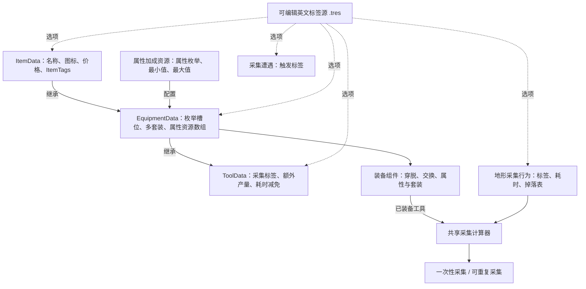

# 装备、工具与英文标签系统

本文记录当前已经实现的配置方式与运行规则。

## 你如何配置

普通物品使用 ItemData。护甲、首饰、武器使用 EquipmentData。斧头、镐子和鱼竿使用继承 EquipmentData 的 ToolData。

| 配置位置 | Inspector 操作 | 含义 |
| --- | --- | --- |
| EquipmentData.ValidSlots | 数组内每个元素选择槽位枚举 | 一件装备允许进入哪些槽位；保留原 0～15 编号 |
| EquipmentData.SetType | 字符串数组 | 同时属于多个套装；例如 iron_set、explorer_set；空数组没有套装 |
| EquipmentData.AttributeBonuses | 添加专用装备属性加成资源 | 每项选择属性枚举、最小加成、最大加成 |
| EquipmentData.GrantedTags | 从英文标签源选择多个标签 | 穿戴后赋予角色，卸下后撤销 |
| ToolData.TargetGatheringTag | 从英文标签源选择一个标签 | 工具作用的采集分类；空值不生效 |
| ToolData.YieldGrowth | 整数，默认 0 | 掉落表内每条成功掉落额外获得的数量 |
| ToolData.GatheringTimeReduction | 非负整数，默认 0 | 匹配工具减少的游戏时间点数 |
| ItemData.ItemTags | 从英文标签源选择多个标签 | 物品分类和现有玩法查询 |
| 采集行为.GatheringTag | 从英文标签源选择一个标签 | 当前地形采集分类 |
| 采集遭遇规则.TriggerTag | 从英文标签源选择一个标签 | 按采集分类触发遭遇 |

工具继承物品和装备的全部配置。名称、图标、说明、价格沿用现有物品字段；装备单件不可堆叠。装备与工具的 `ActualMaxStackSize` 固定为 **1**，即使通用 `MaxStackSize` 被旧资源或 Inspector 设置为其它值，也不会合并独立装备实例。

## 英文标签源

唯一标签源是 `resources/tags/default_tag_catalog.tres`，类型为 `TagCatalog`。在 Godot 文件系统打开它，展开 `Tags` 数组，添加元素并输入英文标识，例如 `ore`，然后保存。相关 Inspector 选择器会更新选项，不需要修改脚本。标签必须以英文字母开头，后面只允许英文字母、数字或下划线。大小写敏感，保留已有大小写；不能把 `MagicItem` 自动改成 `magicitem`。

标签选择器编辑的是原有字符串字段，目录不保存玩家运行状态。已引用但被删除的标签需要警告并保留原引用；不能静默清空。新增标签不自动给任何物品、地形或工具赋值。例如树木采集使用 wood，树枝物品可以具有 branch、wood 两个标签，需要显式配置。拖拽来源 SystemInventory 等内部协议不属于本次标签选项。

目录包含生产 `.tres` 和 `.tscn` 内嵌资源中的既有英文标签，例如主场景遭遇的 `wood`、`stone`、`bush`；原标识保留大小写。删除引用提示同样扫描两种资产格式。插件关闭时停止轮询并断开标签源的监听，重新启用时使用新的监视器。

## 属性与套装

每个装备属性加成资源包含：属性类型枚举、最小加成、最大加成。属性枚举复用现有 0～14 编号，覆盖攻击、防御、速度、生命上限、能量上限、穿透、暴击、闪避和吸血。这里的“生命”是生命上限加成，不是穿戴即治疗。

打开装备文件，在 `AttributeBonuses` 添加元素，选择“新建 EquipmentAttributeBonus”，展开后选择 `Attribute`，填写 `MinValue` 与 `MaxValue`。两处填同一数值表示固定加成；填写不同上下界表示首次生成时随机一次。本次没有给生产装备添加属性数值。

最小值与最大值相同表示固定加成；不同表示物品首次生成时随机一次。同属性多条配置合并到最终值，空元素不产生效果。装备实例保留最终 RolledAttributes，穿脱、复制、交换和读档不重新随机。属性范围倒置应安全规范为正确上下界。

库存的 `AddItem(item, amount)` 与 `ReplaceItem(index, item, amount)` 创建新物品并生成属性。搬运或拾取已有物品使用 `AddItemStack(stack)`，按原有实例属性入库；`CanAddItemStack(stack)` 先判断整份是否放得下。玩家拾取先做完整预检查，放不下时不改变库存和地面掉落，避免一份物品被重复领取。掉落表中装备按每件独立堆叠生成属性，普通物品保留原来的整堆数量。

一件装备可计入多个套装，每个套装独立统计。同一件装备中重复套装标识仅计一次。套装配置以字符串标识对应所属列表，分级效果保留原有满足阶级全部累加的规则。套装加成条目也使用专用资源数组，固定加成不随机，参数和单位要明确。

套装配置使用 `EquipmentSetData`：`SetType` 填单个字符串标识，`Tiers` 添加 `EquipmentSetBonusTier`。阶级的 `RequiredPieces` 是所需件数；`AttributeBonuses` 添加 `EquipmentSetAttributeBonus`，选择 `Attribute` 并填写固定浮点 `Value`；`GrantedTags` 选择达到阶级后赋予的标签。将套装资源登记到装备组件的 `AllSetDatabase`。装备中的套装字符串与配置中的字符串必须一致。项目目前没有生产套装配置，本次不根据金、铁、皮革名称自动创建套装。

## 共享采集计算

一次性采集与可重复采集使用同一计算器：实际耗时 = max(最低耗时, max(基础耗时, 0) - 匹配工具减免)。长按秒数 = 实际耗时 / 10，沿用现有 WorldInteractionTiming 的可调倍率。

资源点明确选择 EffectiveToolSlot，默认 Axe=5；镐子采集点应选择 Pickaxe=6。最低耗时默认 1 点。额外产量沿用所有已装备、匹配采集标签的工具之和。

当前普通树木的基础耗时为 `20` 点，`GatheringTag = wood`；装备 `items/tool/Ax.tres` 后，减免 `17` 点、最低 `1` 点，实际消耗 `max(1, 20 - 17) = 3` 点，对应默认长按 `0.3` 秒。`items/tool/Pickaxe.tres` 保留 `earth` 标签、`10` 点减免、Pickaxe 槽位。其它新迁移工具保持空目标标签、产量 `0`、减免 `0`，需后续显式配置后才产生采集效果。

长按开始时快照实际耗时，完成时扣除同一数值。一次性采集完成后移除资源点；可重复采集完成后扣次数并按游戏时间恢复。两者的状态行为不混合。

## 重构图

## 迁移与验证约定

保留资源路径、UID、CardId、价格、说明和用户已经修改的数值。将旧普通装备和工具资源迁到正确脚本，显式填写合法槽位，不凭名称推断运行时规则。没有配置的属性、套装或工具数值保持中性值，不编造装备强度。

现有数据中 Ax 的时间减免已由用户改为 17 点，本次必须保留；Pickaxe 当前为 10 点。normal_terrain 和 settlement_config 的用户改动也必须保留。存档继续保存物品实例的 RolledAttributes 字典，读取时按新属性资源声明校验属性，不因字典改数组而丢失已有值。

通过 Godot 4.7.1 编辑器验证全局资源类型、真实 Inspector 选择器、装备交换、多个套装、属性生成与存档往返，以及 Main 场景的采集耗时和掉落。测试结束只停止游戏，保留编辑器。
